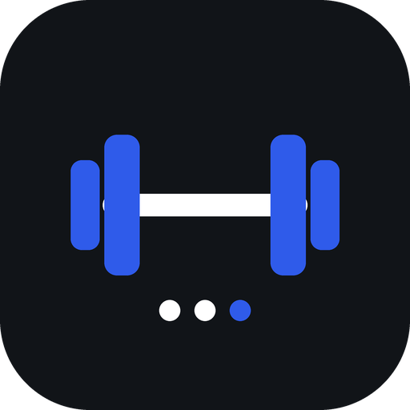
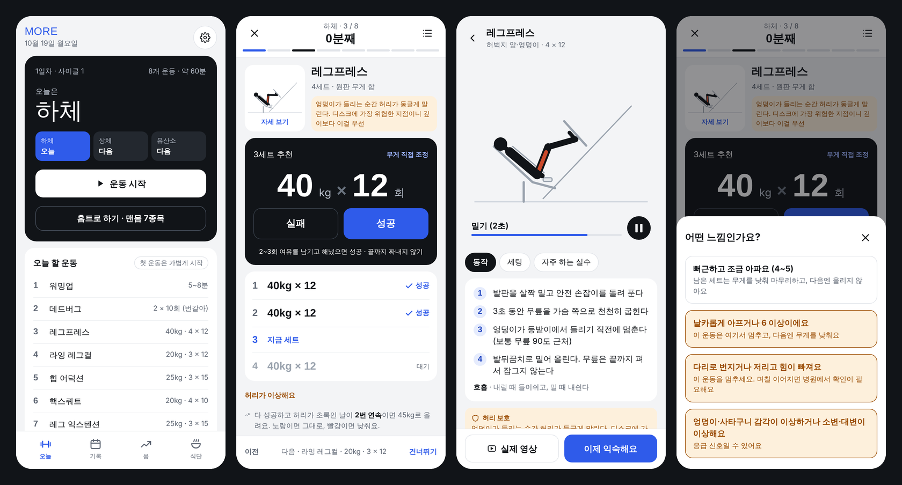

<div align="center">



# MORE

**My Optimal Recovery & Exercise**
허리를 지키면서, 하루씩 더.

[](https://github.com/junDevCodes/more/releases/latest/download/more.apk)
[](https://jundevcodes.github.io/more/)

[](https://github.com/junDevCodes/more/actions/workflows/apk.yml)
[](https://github.com/junDevCodes/more/actions/workflows/pages.yml)



</div>

---

## 무엇을 하는 앱인가요

하체 → 상체 → 유산소를 쉬는 날 없이 반복하는 3분할 루틴을, **허리에 부담을 주지 않는 방식으로** 기록하고 진행시키는 개인용 운동 앱이에요.

- **추천 무게대로 하고, 성공/실패만 누르기** — 무게와 횟수는 앱이 정해요. 결과에 따라 다음 추천이 자동으로 바뀌어요.
- **허리 신호등** — 운동마다, 그리고 다음날 아침에 허리 상태를 초록·노랑·빨강으로 남기면 증량을 멈추거나 무게를 낮춰요.
- **움직이는 자세 가이드** — 모든 운동에 동작 그림, 단계별 설명, 자주 하는 실수, 허리 보호 요령이 있어요.
- **체육관 기구 맞춤** — 없는 기구를 끄면 허리에 안전한 대체 운동으로 바뀌어요.
- **홈트 모드** — 헬스장에 못 가는 날은 맨몸 하체 루틴으로.
- **몸 · 식단** — 체중·인바디 그래프, 마이옵티멀 식단 4끼 체크.
- **PIN 잠금 · 오프라인 · 백업** — 기록은 이 휴대폰 안에만 저장돼요.

## 설치

### Android 앱 (APK)

폰에서 아래 링크를 누르면 바로 받아져요.

```
https://github.com/junDevCodes/more/releases/latest/download/more.apk
```

1. 받은 `more.apk`를 열어 설치 (처음 한 번은 "출처를 알 수 없는 앱 설치" 허용)
2. 새 버전도 같은 링크로 받아 **덮어 설치**하면 기록이 그대로 유지돼요

### 웹앱 (설치형)

크롬에서 **https://jundevcodes.github.io/more/** 를 열고 메뉴 → **앱 설치** (아이폰은 사파리 공유 → 홈 화면에 추가).
인터넷이 없어도 열리고, 업데이트는 자동이에요.

> APK와 웹앱은 기록을 따로 저장해요. 하나만 골라 쓰고, 옮길 때는 설정 → 백업 파일 저장 / 복원을 쓰세요.

## 허리를 지키는 원칙

운동 선택과 기준은 요통 진료 지침(Cochrane 2021, ACP 2017, WHO 2023, NASS)과 운동별 척추 부하 연구를 조사해서 정했어요.

| 원칙 | 앱에서는 |
|---|---|
| **중립 척추** — 무게를 든 채 굽히지도, 과하게 젖히지도 않기 | 매달려 다리 들기 → 인클라인 플랭크, 스미스 스쿼트 → 고블릿 박스 스쿼트, 숄더프레스는 등받이 필수 |
| **몸통을 받쳐주는 기구 우선** | 체스트 서포티드 로우, 시티드 레그컬을 기본으로 |
| **깊이 제한** | 레그프레스·핵스쿼트는 엉덩이가 패드에서 뜨기 직전까지만 |
| **통증으로 진행 속도 조절** | 다 성공 + 허리 초록 2번 연속일 때만 증량, 노랑이면 동결, 빨강이면 낮춤 |
| **빠른 걷기·자전거 중심 유산소** | 달리기는 걷기와 섞어 작게 시작, 걷다가 다리가 저리면 자전거로 |
| **아침엔 굽히는 동작 뒤로** | 아침 운동이면 워밍업에서 안내 |

**MORE는 진단 도구가 아니에요.** 엉덩이·사타구니 감각 저하, 소변·대변 이상, 양쪽 다리 증상, 점점 심해지는 다리 힘 빠짐이 있으면 운동을 멈추고 바로 응급실로 가세요. 허리 상태가 어느 쪽(굽힐 때/젖힐 때)에 민감한지는 재활의학과·물리치료 평가로 확인하는 게 가장 정확해요.

## 구조

```
index.html             앱 전체 (HTML·CSS·JS 한 파일, 외부 라이브러리 없음)
manifest.webmanifest   웹앱 설치 정보
sw.js                  오프라인 캐시
capacitor.config.json  APK 포장 설정 (Capacitor)
.github/workflows/
  apk.yml              main에 올리면 APK 빌드 → Releases
  pages.yml            main에 올리면 웹앱 → GitHub Pages
```

로컬에서 보기: `npx serve .` 후 `http://localhost:3000`

<div align="center"><sub>Made for one person, one spine.</sub></div>
